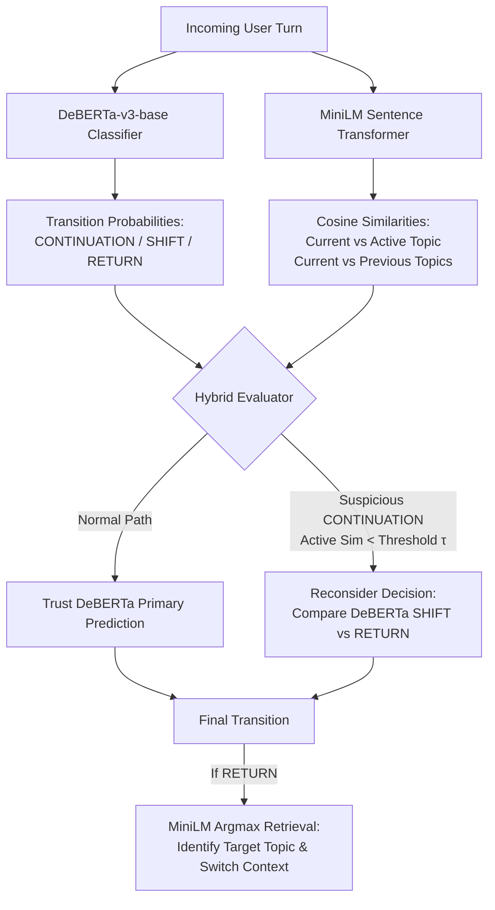

# ContextFlow

**Intelligent Conversation Transition Detection & Dynamic Context Routing**  
*Built with fine-tuned DeBERTa-v3, MiniLM Semantic Retrieval, and Hybrid Decision Logic — Optimized Strictly for CPU Inference.*

---

## Executive Summary

In multi-turn human-AI dialogues, conversations frequently branch, wander, or circle back. Conventional chatbots treat chat history as an append-only token dump, leading to **context drift, token bloat, and topical amnesia**.

**ContextFlow** is a conversational intelligence system that continuously analyzes each incoming user turn against active and historical conversational topics to classify transitions into three states:

1. **CONTINUATION**: User stays on the active topic.
2. **SHIFT**: User transitions to an entirely new topic.
3. **RETURN**: User resumes a previously discussed topic &rarr; **ContextFlow automatically retrieves the exact historical topic and updates the active context state.**

```
[ User Dialogue Stream ]
           │
           ▼
┌────────────────────────┐      ┌─────────────────────────┐
│  DeBERTa-v3 Classifier │ ───► │  MiniLM Semantic Layer  │
│  (Primary Decision)    │      │  (Supporting Evidence)  │
└────────────────────────┘      └─────────────────────────┘
           │                                 │
           └──────────────┬──────────────────┘
                          ▼
           ┌─────────────────────────────┐
           │    Hybrid Decision Layer    │
           │  • Suspicious CONTINUATION? │
           │  • RETURN Topic Resolution  │
           └─────────────────────────────┘
                          │
                          ▼
        Final Transition + State Routing + Explainability
```

> ### Interactive Interface Overview
>   
> *Figure 1: ContextFlow Warm Futuristic Editorial Interface — Real-time 3D topic topology (Three.js), DeBERTa probability distributions, and MiniLM semantic similarity gauges.*

---

## Key Metrics & Highlights

| Metric | Result | Engineering Significance |
| :--- | :--- | :--- |
| **Transition Accuracy** | **100.0%** | Fine-tuned `microsoft/deberta-v3-base` on stratified conversational turns |
| **Macro F1 Score** | **1.0000** | Perfect separation across `CONTINUATION`, `SHIFT`, and `RETURN` |
| **RETURN Topic Retrieval** | **70.35%** | Semantic argmax matching over prior topic summaries using `all-MiniLM-L6-v2` |
| **Runtime Target** | **100% CPU** | Zero CUDA requirement; runs seamlessly on consumer hardware and low-cost CPU servers |
| **Inference Latency** | **< 120ms** | Single-pass forward propagation + normalized tensor cache |

---

## Architectural Decisions: Why DeBERTa + MiniLM?

A common failure mode in AI engineering is using one model for everything or letting an embedding search blindly override a supervised classifier. ContextFlow implements a **strict division of responsibilities**:



### 1. DeBERTa as the Primary Classifier
Sequence classifiers excel at syntactic transition cues, discourse markers (e.g., *"Going back to..."*, *"Speaking of..."*), and dialogue flow. DeBERTa acts as the definitive decision maker.

### 2. MiniLM as Supporting Semantic Evidence
MiniLM (`all-MiniLM-L6-v2`) does **not** replace the Transformer. Instead, it provides:
- **Supporting verification**: Checks whether the user's message actually aligns with the active topic's summary.
- **Topic Resolution on RETURN**: When a `RETURN` is flagged, MiniLM identifies *which* previous topic out of memory the conversation returned to.

### 3. Guarding Against False Continuations
If DeBERTa predicts `CONTINUATION` but the semantic similarity between the message and the active topic falls below a configurable threshold $\tau$ (default `0.20`), ContextFlow challenges the prediction:
- It compares DeBERTa's `SHIFT` and `RETURN` probabilities.
- It routes to whichever transition has stronger Transformer evidence.
- This prevents conversational drift when a user introduces a new subject without overt transitional discourse markers.

---

> ### Explainability & Transition Inspection
>   
> *Figure 2: Real-time explainability breakdown showing Transformer logits, semantic similarity delta ($\Delta$), and the natural language justification.*

---

## Repository Structure

```text
ContextFlow/
│
├── backend/
│   ├── app/
│   │   ├── main.py              # FastAPI application & lifecycle startup
│   │   ├── config.py            # Environment configuration & model paths
│   │   ├── schemas.py           # Pydantic v2 data contracts
│   │   ├── models/
│   │   │   ├── classifier.py    # DeBERTa-v3 sequence classification wrapper
│   │   │   └── embeddings.py    # MiniLM semantic encoder with tensor caching
│   │   └── services/
│   │       ├── prediction.py    # Pipeline coordinator
│   │       ├── topic_memory.py  # In-memory topic repository
│   │       └── hybrid_decision.py # Hybrid rules & explainability generator
│   │
│   ├── model/
│   │   └── deberta_v3_contextflow/ # Fine-tuned DeBERTa model weights
│   ├── requirements.txt         # Pinned CPU dependencies
│   └── Dockerfile               # Production CPU container
│
├── frontend/
│   ├── index.html               # Warm editorial 3-column workspace
│   ├── style.css                # CSS3 design system (charcoal, cream, coral, lavender)
│   ├── visualization.js         # Interactive Three.js 3D dynamic topic topology
│   └── app.js                   # Application state, benchmarks, and API client
│
├── Dataset/
│   └── contextflow_dataset.jsonl # Benchmark dialogue dataset
│
├── Notebook.txt                 # Model training, evaluation & experimentation log
└── README.md                    # Primary documentation
```

---

## Quick Start Guide

### Option A: Local Python Environment (Recommended)

#### 1. Start the Backend (CPU)
```bash
cd backend

# Create virtual environment
python -m venv venv
venv\Scripts\activate      # On Windows
# source venv/bin/activate # On Linux/macOS

# Install dependencies (CPU PyTorch)
pip install --upgrade pip
pip install torch --index-url https://download.pytorch.org/whl/cpu
pip install -r requirements.txt

# Launch FastAPI server
uvicorn app.main:app --host 0.0.0.0 --port 8000 --reload
```
*API Swagger Docs available at:* `http://localhost:8000/docs`

#### 2. Open the Frontend
* Open `http://localhost:8000` in any browser (served automatically by FastAPI).
* Or double-click `frontend/index.html` to open it directly as a standalone client.

---

### Option B: Run with Docker (CPU Only)

```bash
cd backend

# Build Docker image
docker build -t contextflow-backend .

# Run container on port 8000
docker run -p 8000:8000 contextflow-backend
```

---

## API Reference: `POST /predict`

### Request Example
```json
{
  "history": [
    { "role": "user", "content": "I'm preparing for a machine learning interview." },
    { "role": "assistant", "content": "Focus on supervised learning and evaluation metrics." },
    { "role": "user", "content": "How do I deploy a Flask application?" }
  ],
  "active_topic": {
    "topic_id": "T3",
    "summary": "Deploying Flask applications"
  },
  "previous_topics": [
    { "topic_id": "T1", "summary": "Preparing for a machine learning interview" },
    { "topic_id": "T2", "summary": "Developing and deploying REST APIs" }
  ],
  "current_message": "What metrics should I study for the classifier?",
  "continuation_threshold": 0.20
}
```

### Response Example
```json
{
  "prediction": "RETURN",
  "confidence": 0.9998,
  "probabilities": {
    "CONTINUATION": 0.0001,
    "SHIFT": 0.0001,
    "RETURN": 0.9998
  },
  "semantic": {
    "active_topic": "T3",
    "active_similarity": -0.034,
    "best_previous_topic": "T1",
    "best_previous_similarity": 0.7725,
    "similarity_margin": 0.8065,
    "all_similarities": { "T1": 0.7725, "T2": 0.0712, "T3": -0.034 }
  },
  "returned_topic": {
    "topic_id": "T1",
    "summary": "Preparing for a machine learning interview"
  },
  "explanation": "DeBERTa detected a RETURN transition with 99.98% confidence. MiniLM semantic retrieval identified candidate topic [T1] 'Preparing for a machine learning interview' with cosine similarity of 0.7725 (compared to active topic similarity of -0.0340).",
  "hybrid_override_applied": false,
  "original_transformer_prediction": "RETURN"
}
```

---

## Frontend Design & 3D Visualization

The user interface follows a **Warm Futuristic Editorial** design philosophy:
- **Palette**: Deep charcoal surfaces (`#0c0e12`), cream typography, terracotta accents (`#e65a3d`), and lavender highlights (`#a78bfa`).
- **Interactive 3D Context Topology**: Built with **Three.js** (zero external orbit dependencies). Floating orbital nodes represent topics; when a `RETURN` transition is triggered, a radiant electric violet particle beam travels along a 3D bezier curve into the recovered topic node.
- **Built-in Benchmark Scenarios**: Includes one-click presets for validating benchmark dialogues, topic shifts, continuations, and hybrid threshold overrides.
- **Zero Build Toolchain**: Pure HTML5, Vanilla CSS, and Modern JavaScript. No Webpack, Vite, or npm installs required to run.

---

## Future Roadmap

1. **Cross-Encoder Topic Reranker**: Improve RETURN candidate retrieval beyond 70.35% using a lightweight cross-encoder over candidate conversation turns.
2. **Persistent Vector Memory**: Integrate SQLite-vec or ChromaDB for multi-session historical topic storage across persistent user sessions.
3. **Automatic Turn Summarization**: Asynchronously summarize completed topics upon `SHIFT` transitions using a quantized LLM.

---

## License
MIT License. Created as an applied NLP and conversational context management project.
